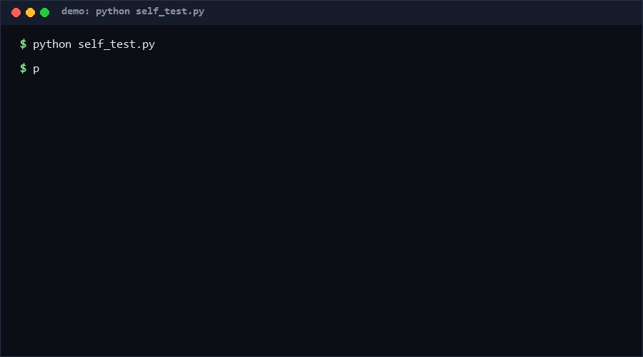

# plugin-manifest-spec

A host-agnostic JSON manifest that declares an agent plugin's skills, connectors, commands, and subagents in one file, plus a validator and multi-host install planner. If you ship one plugin and want it installable on several agent hosts without rewriting the packaging for each — this spec is for you.

**Confidence: High (85%)** that the four-block structure is the right decomposition; it is observable across multiple official plugin repos today.

<p align="center"></p>

## Problem

Agent plugin packaging is currently host-proprietary: the same four capability blocks exist everywhere, but every host invents its own directory layout and none exposes an installability contract.

- **Why novel:** connectors deserve to be an *explicit contract*, not a side effect. Each plugin declares a connector table (id, auth, scopes, permissions) — an OAuth connector without declared scopes is invalid, which turns silent permission creep into a validation error.
- **Overlooked angle:** the four-block layout (skills + connectors + commands + subagents) that official plugins already converge on *is* a package-format standard in the making. Most people install plugins without noticing they are looking at a schema.

## How it works

```jsonc
{
  "name": "market-research",        // kebab-case slug
  "version": "0.1.0",               // semver
  "description": "…",
  "skills":     [{"id": "price-check", "path": "skills/price-check/SKILL.md"}],
  "connectors": [{"id": "market-feed", "auth": "api_key", "permissions": ["read:quotes"]}],
  "commands":   [{"name": "benchmark", "description": "Run a price benchmark"}],
  "subagents":  [{"name": "comp-analyst", "prompt_path": "agents/comp-analyst.md"}]
}
```

The validator (`manifest_spec.validate`) returns structured error codes (E001 missing field, E010 bad slug, E033 oauth-without-scopes, E020 duplicate skill id, …). The planner (`plan_install`) intersects the manifest with a host capability matrix:

| Host | skills | connectors | commands | subagents |
|---|---|---|---|---|
| generic-agent | Y | Y | Y | Y |
| cli-host-a | Y | Y | Y | – |
| cli-host-b | Y | – | Y | – |
| ide-host | Y | Y | – | – |

A manifest targeting `cli-host-b` with subagents plans as `partial` — visible *before* install, not as a runtime surprise.

## Quickstart (~1 min)

```bash
# 1. Validate the shipped examples (~2 s)
python cli.py validate examples/valid.minimal.json
python cli.py validate examples/invalid.demo.json     # see the error codes

# 2. Check installability on a host (~2 s)
python cli.py plan examples/valid.minimal.json --host ide-host

# 3. Generate a starter manifest (~2 s)
python cli.py example > my-plugin.json && python cli.py validate my-plugin.json
```

All steps offline, pure standard library.

## Why not X

| Alternative | Why not |
|---|---|
| Host-native plugin formats | Each locks you to one host; no cross-host install plan; connector scopes often implicit |
| JSON Schema + `jsonschema` lib | Only validates shape, cannot express the oauth-scopes rule or run the host-capability plan; also adds a dependency where zero suffices |
| Packagers (npm/pip) | Solve code distribution, not capability declaration; an agent host cannot read `setup.py` to learn which connectors need OAuth consent |
| Convention-over-config directories | Silent behavior differences across hosts; this spec makes every block explicit, including empty ones |

## Minimal Fallback (PLAN B)

No Python? The spec is one JSON file — copy `examples/valid.minimal.json`, edit by hand, and eyeball the error-code table in this README. The validator is a convenience; the manifest format itself has zero toolchain requirements.

## Design Trade-offs

Priority: **explicitness > portability > brevity.** Empty blocks must be declared (`"subagents": []`) so a host can distinguish "no subagents" from "author forgot"; slug/semver rules are strict to keep cross-host resolution deterministic; error codes are stable strings (E0xx), not prose, so CI can gate on them.

## Limits & Second-order Effects

- **Limits:** the capability matrix is static and must track host evolution; the spec checks declarations, not whether referenced files actually exist or skills behave correctly.
- **Second-order effects:** a shared manifest standard may flatten host differentiation — hosts compete on runtime quality instead of packaging lock-in (good for users, risky for platform vendors). Widespread adoption could also make "connector scope lists" a checkbox exercise, recreating the permission-bloat problem the explicit contract was meant to prevent.

## FAQ

**Q: Is this officially adopted by any host?**
No. It is an independent spec with a reference validator. The matrix ships with 4 example hosts; edit `HOST_CAPABILITIES` for yours.

**Q: When you should NOT use this spec**
- You target exactly one host and will never leave it — host-native format is simpler.
- Your plugin is purely static content (one skill file) — the four-block ceremony outweighs the value.
- You need dependency/version resolution between plugins — this spec is single-plugin scope.

**Q: Why must empty blocks be declared?**
Explicitness rule: `"subagents": []` proves the author considered subagents and chose none; absence proves nothing and breaks deterministic install plans. [High confidence: explicit declaration is the only encoding that survives host schema drift]

## Core Assumptions

1. The skills/connectors/commands/subagents decomposition covers the capability space current agent plugins actually package.
2. Hosts differ mainly in *which blocks they support*, not in block semantics, so a capability matrix is a faithful portability model.
3. Declarative connector contracts (auth + scopes) can capture the security-relevant surface of an install without executing code.

*Spec version 0.1 as of 2026-09-20. Contact: hcac4735@agent.qq.com*
